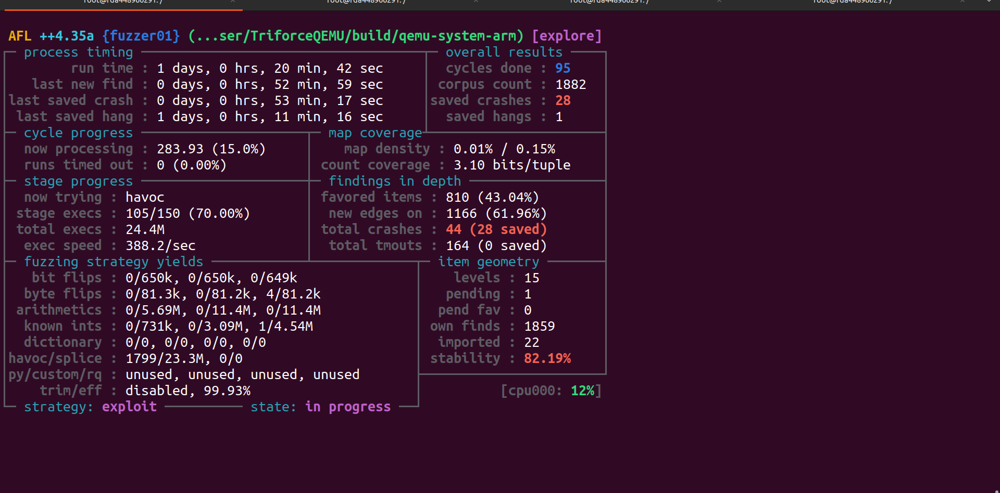

# Concolic Fuzzing
This repo sets up fuzzer and concolic executor for concolic fuzzing. Basically, it compiles TriforceQEMU and full system SymQEMU (concolic-replay). TriforceQEMU is another project that implements full system fuzzing with the help of rehosting. This setup only supports Linux machine. For a MCU firmware, assume that inputs come from MMIO regions or a socket interface for example, such that we could symbolize a receiving value from any of them to propagate collected constraints through execution and finally let a SMT solver obtain values, that allow an execution to this path.

# Environment Setup
Install the following for QEMU compile.
```
sudo apt install git libglib2.0-dev libgcrypt20-dev     \
 zlib1g-dev autoconf                                    \
 automake libtool bison flex libpixman-1-dev            \
 python3-venv meson cmake python3-pip                   \
 llvm wget curl
```

Install Rust cargo
```
curl https://sh.rustup.rs -sSf | sh
```

Then run `./build_fuzzer_and_concolic_executor.sh` to build TriforceQEMU, concolic-replay, AFL++4.34.

# Run a test fuzzing

Run the fuzzer first.
``` 
mkdir ./AFLplusplus/input
mkdir ./AFLplusplus/output
perl -E 'say "A" x 80' > AFLplusplus/input/input1

./AFLplusplus/afl-fuzz                                   \
  -M fuzzer01                                            \
  -i ./AFLplusplus/input/                                \
  -o ./AFLplusplus/output                                \
  -t 2000                                                \
  --                                                     \
  ./TriforceQEMU/build/qemu-system-arm                   \
  -M rehost-fuzzing                                      \
  -display none                                          \
  -kernel ./fw-example/nucleo753zi/aflConfiguration.json \
  -aflFile @@
```

Run afl fuzzing helper that leverages concolic executor to guide fuzzing progress of main instance.
```
symcc_fuzzing_helper                                    \
 -v -o ./AFLplusplus/output                             \
 -a fuzzer01 -n symqemu                                 \
 -- ./concolic-replay/build/qemu-system-arm             \
 -M concolic-execution                                  \
 -display none                                          \
 -kernel ./TriforceQEMU/patches/fw-example/nucleo753zi/aflConfiguration.json                                                   \
  -replayFile @@
```


# Example

The image shows a fuzzer as a main instance running in parallel mode and scanning queue folders of other instances in the meanwhile.



The symcc fuzzing helper watches new test cases of the main instance, and pick the most promising testcase for concolic exploration. It generates new testcase by following AFL testcase naming convention, which are taken advantage of when deemed interesting by the main instance fuzzer.


# Firmware Configuration

Read [Writing a firmware configuration from scratch](docs/firmware-configuration.md)
for a step-by-step walkthrough of the STM32H7S78-DK example. It explains how to
derive addresses from the ELF, prepare a raw flash image, configure memory and
CPU state, choose MMIO or PC-based symbolization, add hooks and stop conditions,
schedule interrupts, and validate both engines before fuzzing.

Both engines accept a shared JSON file through `-kernel`, with some differences:
`symbolize_at_pc` affects only concolic-replay, and `aflDmesgAddr` currently has no
active logging effect. The tutorial documents these details and includes a
complete configuration and commands for replay, AFL, and the concolic helper.


## Visualizing coverage in Ghidra Cartographer

Export observed address ranges as EZCOV coverage:

```sh
./TriforceQEMU/build/qemu-system-arm \
  -M rehost-fuzzing -display none \
  -kernel runs/nucleo753zi.json -aflFile runs/input/seed \
  -covFile runs/seed.ezcov
```

Open the matching `fw-example/nucleo753zi/nucleo-h753zi-RnR.elf` in Ghidra,
with [Cartographer](https://github.com/nccgroup/Cartographer) installed. Select
**Tools → Code Coverage → Load Code Coverage File(s)** and load the EZCOV file.
**Window → Code Coverage** opens the function coverage table; the Listing,
Decompiler and Function Graph can show the executed regions.


*A view from this project: Cartographer highlights loaded coverage ranges in the
disassembly and decompiled C. This illustration is separate from the runs in
the [validation record](docs/validation.md).*

The overlay describes the ranges in the loaded file. The current exporter does
not include every block-entry PC observed in the execution log; see
[the export checks](docs/validation.md#coverage-export). An uncolored region is
therefore not proof that execution never reached it. The overlay also does not
measure physical-device coverage or prove a hybrid-fuzzing advantage. Use the
same firmware image and address mapping in Ghidra and the emulator.

# Utility
* `utils/aggregate_queue_cov.sh`: make a cumulative code coverage;
* `utils/search_interesting_bb.sh`: look for interesting basic blocks, e.g., `search_interesting_bb.sh queue_folder bb1, bb2, bb3…` ;
* `test_same_exec_flows_over_testset.sh` and `utils/single_compare_test_case.sh`: compare whether execution flows between TriforceQEMU and concolic-replay are the same under a test case or a test set;


# Work in Progress

* Porting to RH850
* More coordination strategies between fuzzer and concolic executor
* More firmset under test (fuzzware, P2IM)
* Benchmarking pure AFL++ in hybrid mode and the one with concolic execution in use


## Attribution and licensing

The original scripts, tests, configurations and documentation in this
superproject are licensed under **GPL-3.0-only**. See [LICENSE](LICENSE) for the
full text and [LICENSING.md](LICENSING.md) for scope and exclusions.

This work builds on QEMU, AFL/Triforce integration, SymQEMU, SymCC and the Qsym
backend. Their existing licenses and attribution files continue to apply.
The firmware examples were created by this project's author. Their original
application code uses GPL-3.0-only; vendor/runtime components retain their own
terms. The [provenance record](docs/firmware-provenance.md) identifies matching
prebuilt copies, with source/build and component-notice packaging remaining in
[release readiness](docs/release-readiness.md).
