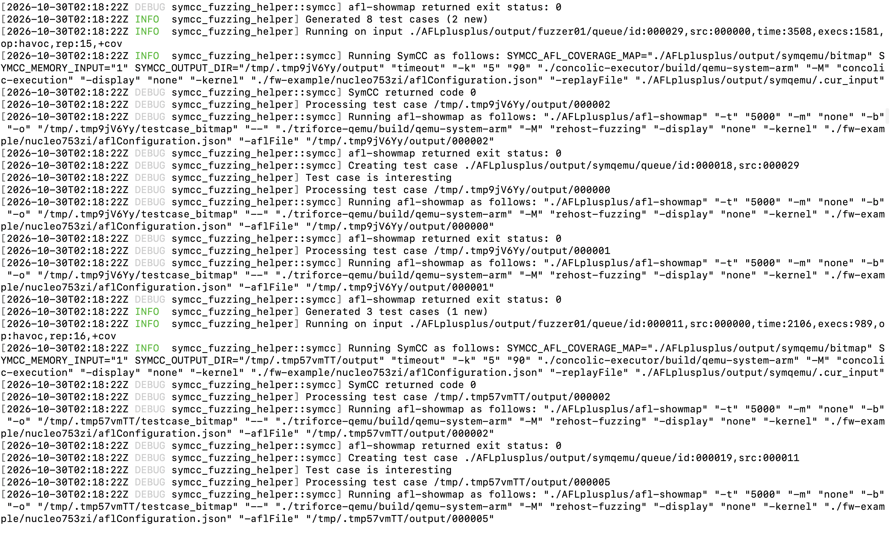
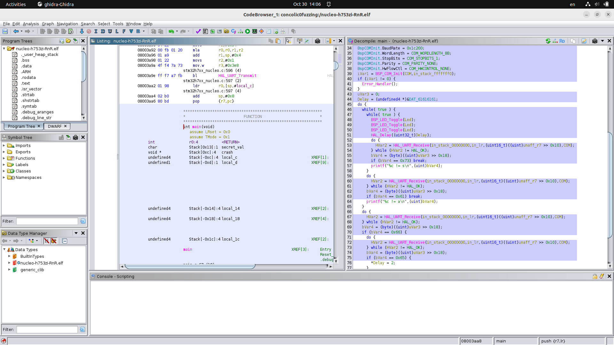

# Concolic Fuzzing
This repo sets up fuzzer and concolic executor for concolic fuzzing. Basically, it compiles triforce-qemu and full system SymQEMU (concolic-executor). triforce-qemu is another project that implements full system fuzzing with the help of rehosting. This setup only supports Linux machine. For a MCU firmware, assume that inputs come from MMIO regions or a socket interface for example, such that we could symbolize a receiving value from any of them to propagate collected constraints through execution and finally let a SMT solver obtain values, that allow an execution to this path.

# Environment Setup
Install the following for QEMU compile.
```
sudo apt install git libglib2.0-dev libgcrypt20-dev     \
 zlib1g-dev autoconf                                    \
 automake libtool bison flex libpixman-1-dev            \
 python3-venv meson cmake python3-pip                   \
 llvm wget curl
```

Install Rust cargo
```
curl https://sh.rustup.rs -sSf | sh
```

Then run `./build_fuzzer_and_concolic_executor.sh` to build triforce-qemu, concolic-executor, AFL++4.34.

Both QEMU forks compile the same versioned hook sources. The build initializes
their nested `hooks` submodules and checks that their revisions match. See
[shared firmware hooks](docs/shared-hooks.md) for the adapter interface and update workflow.

After building, add `symcc_fuzzing_helper` to your `PATH` for future Bash or Zsh terminals:
```sh
./setup_env.sh
```


# Run a test fuzzing

Run the fuzzer first.
``` 
mkdir -p ./AFLplusplus/input
mkdir -p ./AFLplusplus/output
perl -E 'say "A" x 80' > AFLplusplus/input/input1

./AFLplusplus/afl-fuzz                                   \
  -M fuzzer01                                            \
  -i ./AFLplusplus/input/                                \
  -o ./AFLplusplus/output                                \
  -t 2000                                                \
  --                                                     \
  ./triforce-qemu/build/qemu-system-arm                   \
  -M rehost-fuzzing                                      \
  -display none                                          \
  -kernel ./fw-example/nucleo753zi/aflConfiguration.json \
  -aflFile @@
```

Run afl fuzzing helper that leverages concolic executor to guide fuzzing progress of main instance.
```
symcc_fuzzing_helper                                    \
 -v -o ./AFLplusplus/output                             \
 -a fuzzer01 -n symqemu                                 \
 -- ./concolic-executor/build/qemu-system-arm             \
 -M concolic-execution                                  \
 -display none                                          \
 -kernel ./fw-example/nucleo753zi/aflConfiguration.json    \
  -replayFile @@
```


# Example

The image shows a fuzzer as a main instance running in parallel mode and scanning queue folders of other instances in the meanwhile.


The symcc fuzzing helper watches new test cases of the main instance, and pick the most promising testcase for concolic exploration. It generates new testcase by following AFL testcase naming convention, which are taken advantage of when deemed interesting by the main instance fuzzer.



## Reproduce A Crash Case

```bash
./triforce-qemu/build/qemu-system-arm   \
-M rehost-fuzzing -display none   \
-kernel ./fw-example/nucleo753zi/aflConfiguration.json \
-aflFile ./AFLplusplus/output/fuzzer01/crashes/id:000000,sig:06,sync:symqemu,src:000423   \
```

You will see in the terminal:
```
[delay_hook_0]
Unassigned mem write 0000000040004820 = 0x8
Unassigned mem write 0000000040004800 = 0x62626242
Unassigned mem write 0000000040004808 = 0x413e3e3e
Unassigned mem write 0000000040004808 = 0x62836262
Unassigned mem write 0000000040004808 = 0xb4b4d3b4
Unassigned mem write 0000000040004808 = 0xb4b4b4b4
Unassigned mem write 0000000040004808 = 0x62626262
Unassigned mem write 0000000061616161 = 0x2
Aborted
```
where a out-of-bound memory access takes place, being recorded via logging.


## Visualizing coverage in Ghidra Cartographer

If you want to see a colorful coverage in Ghidra, export observed address ranges as EZCOV coverage:

```bash
./triforce-qemu/build/qemu-system-arm   \
-M rehost-fuzzing -display none   \
-kernel ./fw-example/nucleo753zi/aflConfiguration.json \
-aflFile ./AFLplusplus/output/fuzzer01/crashes/id:000000,sig:06,sync:symqemu,src:000423   \
-covFile crash.ezcov
```

Open the matching `fw-example/nucleo753zi/nucleo-h753zi-RnR.elf` in Ghidra,
with [Cartographer](https://github.com/nccgroup/Cartographer) installed. Select
**Tools → Code Coverage → Load Code Coverage File(s)** and load the EZCOV file.
**Window → Code Coverage** opens the function coverage table; the Listing,
Decompiler and Function Graph can show the executed regions.




# Firmware Configuration

Read [Writing a firmware configuration from scratch](docs/firmware-configuration.md)
for a step-by-step walkthrough of the STM32H7S78-DK example. It explains how to
derive addresses from the ELF, prepare a raw flash image, configure memory and
CPU state, choose MMIO or PC-based symbolization, add hooks and stop conditions,
schedule interrupts, and validate both engines before fuzzing.

Both engines accept a shared JSON file through `-kernel`, with some differences:
`symbolize_at_pc` affects only concolic-executor, and `aflDmesgAddr` currently has no
active logging effect. The tutorial documents these details and includes a
complete configuration and commands for replay, AFL, and the concolic helper.


# Utility
* `utils/aggregate_queue_cov.sh`: make a cumulative code coverage;
* `utils/search_interesting_bb.sh`: look for interesting basic blocks, e.g., `search_interesting_bb.sh queue_folder bb1, bb2, bb3…` ;
* `test_same_exec_flows_over_testset.sh` and `utils/single_compare_test_case.sh`: compare whether execution flows between triforce-qemu and concolic-executor are the same under a test case or a test set;


# Work in Progress

* Porting to RH850
* ~~More coordination strategies between fuzzer and concolic executor~~
  * Have found that the current coordination strategy works properly, but the bottleneck is that concolic execution usually gets limited by input exhaustion from peripheral polling like UART's data presence waiting; 
* More firmset under test (fuzzware, P2IM)
* Benchmarking pure AFL++ in hybrid mode and the one with concolic execution in use
* A verifier for symbolic constraint propagation
* Establish a intermediate layer from C to Python/DSL to easily write a hook func

## Attribution and licensing

The original scripts, tests, configurations and documentation in this
superproject are licensed under **GPL-3.0-only**. See [LICENSE](LICENSE) for the
full text and [LICENSING.md](LICENSING.md) for scope and exclusions.

This work builds on QEMU, AFL/Triforce integration, SymQEMU, SymCC and the Qsym
backend. Their existing licenses and attribution files continue to apply.
The firmware examples were created by this project's author. Their original
application code uses GPL-3.0-only; vendor/runtime components retain their own
terms. The [provenance record](docs/firmware-provenance.md) identifies matching
prebuilt copies, with source/build and component-notice packaging remaining in
[release readiness](docs/release-readiness.md).
