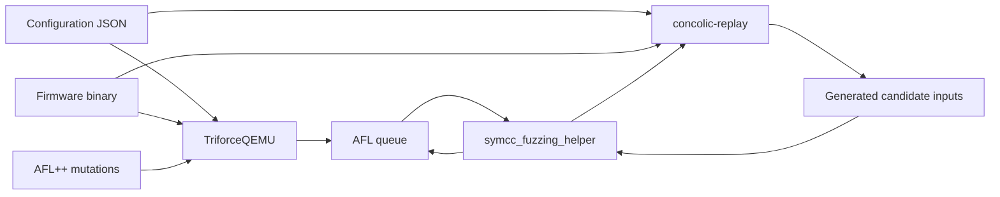

# Writing a firmware configuration

An `aflConfiguration.json` describes the environment in which the firmware
runs: its memory map, starting CPU state, input sources, function hooks, stop
conditions, and interrupt schedule. Both custom QEMUs accept this file through
`-kernel`; the firmware image itself belongs in `flash[].file`.

This tutorial derives a configuration from
[`fw-example/stm32h7s78-dk/aflConfiguration.json`](../fw-example/stm32h7s78-dk/aflConfiguration.json)
and its matching ELF. The addresses below belong to that binary. 

## 1. Understand what the configuration controls



TriforceQEMU reports coverage to AFL++ for guiding input mutation. The helper selects queued inputs for
concolic-replay, which tracks symbolic values and asks its solver for candidate
inputs. The helper feeds candidates back into the fuzzing workflow. This is the
intended feedback loop; useful coverage gains still need to be measured.

Like the example configuration, it provides a configurable ARMv7-M environment, by adding an MMIO range which would be fed with fuzzing inputs;
Accesses to otherwise unassigned addresses out of that range would not use the fuzz stream and hit the normal decode error.
Additionally, the cpu model "cortex-m7" selects NVIC of ARMv7-M to drive interrupt handling.

## 2. Collect evidence from the firmware

Start with the matching ELF, raw flash image if available, linker script/map,
and startup code. For firmware without symbols, try [binbloom](https://github.com/quarkslab/binbloom) to find a loading address.
It is best if you have knowledge about its chips, then you could find its datasheet online.

In case that you have ELF binary. Use your favorite tools to inspect information about flash, RAM, the loading address, the vector table , etc.

## 3. Define RAM, flash, and the reset mapping

Use quoted hexadecimal strings for addresses and sizes:

```json
{
  "ram": [
    {"name": "SRAM", "addr": "0x24000000", "size": "0x20000"},
    {"name": "DTCM", "addr": "0x20000000", "size": "0x20000"}
  ],
  "flash": [
    {
      "name": "code flash#0",
      "addr": "0x08000000",
      "size": "0x20000",
      "alias_at": "0x0",
      "file": "stm32h7s78-dk.bin"
    }
  ]
}
```

Each region covers `[addr, addr + size)`. Here each region is 128 KiB. The SRAM
range covers the ELF's data and RTT addresses, and the DTCM range covers the
stack. These are the example's emulated regions, not a claim about the board's
complete physical memory capacity.

`alias_at` maps the same flash bytes at a second address. With the vector table
at the beginning of this image, the zero alias makes its initial stack and reset
vectors available at `0x0` and `0x4`. Later, this firmware's `SystemInit` sets
VTOR to `0x08000000`. An alias does not relocate instructions or repair a binary
linked for a different address.

`file` is relative to the JSON file's directory, not the shell's current
directory. In the working directory above, save the JSON beside the extracted
binary. Absolute filenames also work.

Optional `file_offset` and `file_bytes` select part of an input file. Unlike
addresses, both are JSON integers, for example `"file_offset": 512` and
`"file_bytes": 4096`. Omit `file_offset` for offset zero: the current loader
asserts that an explicitly requested seek returns a positive offset. Ensure
the selected bytes exist and fit within `size`.

## 4. Select the CPU and starting state

```json
{
  "cpu_model": "cortex-m7",
  "entry_address": "0x080024cd"
}
```

The current machine definitions list `cortex-m7` as their valid CPU type. A new
architecture or board model may require code changes beyond JSON.

The loader sets PC to `entry_address & ~1` and Thumb state from bit 0. For this
Cortex-M image, use the odd reset-vector value `0x080024cd`. For `patch`,
`exit_at`, `aflPanicAddr`, and `symbolize_at_pc`, use the even instruction address
shown in disassembly.

Starting at the reset handler lets the firmware establish SP, copy `.data`,
clear `.bss`, and initialize its runtime. Jumping directly into `main` or a parser
requires you to supply everything that skipped startup would have established.
In TriforceQEMU, `entry_address` also sets the AFL forkserver entry marker; verify
that execution reaches it.

`init_state` optionally writes general registers after CPU creation:

```json
{
  "init_state": [
    {"r0": "0x12345678"},
    {"r1": "0xdeadbeef"},
    {"r13": "0x20010000"}
  ]
}
```

Use one register per object: the implementation reads only the first key of
each object. Accepted names are `r0` through `r14` and `pc`, case-insensitively;
use `r13` for SP and `r14` for LR. Aliases such as `sp`, `lr`, and `r15` are not
recognized. Setting `pc` here does not update Thumb state or the AFL entry
marker, so use `entry_address` to select the start location. This facility does
not restore RAM, VTOR, or other special CPU/peripheral state.

## 5. Decide how fuzzing input enters execution

### Concrete input through MMIO

```json
{
  "mmio": [
    {"mmio_start": "0x40000000", "mmio_end": "0x60000000"}
  ]
}
```

MMIO is an area where MCU interacts with outside. When there is a mmio range in a config file, it means that all MMIO read would be fed with fuzzing input or custom input, to either exercise firmware logic or reproduce the same software behavior. So, set up a MMIO region according to where your firmware eats input from peripherals. For the concolic executor, it would symbolize all MMIO read in that region, and make it propagate through execution, deriving constraints and solving as concrete values.


### Symbolic input in the concolic executor

There are two choices to symbolize a value off read operations:

| Choice | Configuration | Effect in replay |
| --- | --- | --- |
| MMIO symbolization | Configure `mmio`; omit `symbolize_at_pc`. | The configured unassigned MMIO reads receive concrete input bytes and symbolic expressions. |
| Symbolization at selected PCs | Add a nonempty `symbolize_at_pc` list. | MMIO still supplies concrete input, but its automatic symbolization is disabled. Selected non-MMIO loads make the accessed memory symbolic when it has no expression already. |

The STM32 example uses the second choice:

```json
{"symbolize_at_pc": ["0x0800041e"]}
```

Disassembling around that address explains why:

```text
0x08000414: bl     HAL_UART_Receive
0x08000418: cbz    r0, 0x0800041e
...
0x0800041e: ldrb.w r0, [sp, #0xb]
0x08000422: cmp    r0, #0x73
0x08000424: beq    0x0800043a
```

On a successful receive, the program loads one byte from its stack and compares
it with `'s'`. The configured address is the load instruction's PC, not the
stack address and not the UART data-register address. This focuses symbolic
tracking on a value used by the application. TriforceQEMU ignores this key.

## 6. Choose hooks, normal stops, and crashes

### Bypass functions with `patch`

Each entry uses both fields, with different roles:

- **`addr` triggers interception.** The runtime checks whether the guest PC at
  a translation-block entry equals this address.
- **`name` selects the callback.** It is an exact, case-sensitive key registered
  in the emulator's `hook_init()`. It does not look up a function name in the
  firmware or resolve an ELF symbol to an address.

```json
{
  "patch": [
    {"addr": "0x08002648", "name": "HAL_Delay"},
    {"addr": "0x080002c8", "name": "uart_printf"}
  ]
}
```

For the first entry, reaching `0x08002648` retrieves the name `HAL_Delay`, which
selects the registered C callback `delay_hook()`. The second entry invokes
`uart_printf()` when execution reaches `0x080002c8`. A registered name alone
does not trigger a hook if execution never reaches its configured address.

After calling the callback, the runtime redirects the guest PC to LR, if we work on ARM binary, (clearing
bit 0 in Thumb mode) bypassing the firmware function's body. This intercepts
execution at runtime; it does not rewrite the firmware's instruction bytes.
The supplied callbacks are:

| Hook name | Behavior |
| --- | --- |
| `HAL_Delay` | Logs the call and skips the delay. It does not advance the firmware's tick counter. |
| `uart_printf` | Reads a format string through R0 and a limited set of arguments through R1–R3, then prints on the host. It is not a complete `printf` implementation. |

Provide a nonempty name. An unknown name still skips the function and returns
to LR, but runs no callback. For example, `"name": "printf"` in the NUCLEO
configuration does not select the registered `uart_printf` callback. A skipped
function also gets no automatic return value; model R0 and other side effects
when its callers depend on them.

To add a callback, implement and register it in both
[`TriforceQEMU/hw/rehosting/arm/function_hooks.c`](../TriforceQEMU/hw/rehosting/arm/function_hooks.c)
and
[`concolic-replay/hw/concolic/arm/function_hooks.c`](../concolic-replay/hw/concolic/arm/function_hooks.c),
then rebuild both engines. The JSON chooses a compiled hook; it cannot contain
Python or C code. Prefer function-entry addresses, where LR has the expected
return address, and keep behavior consistent across engines.

### Add stop points to speed up a fuzzing campaign

```json
{
  "exit_at": [{"addr": "0x08000b40", "name": "Error_Handler"}],
  "aflPanicAddr": "0x080021ea"
}
```

`exit_at` terminates normally with status 0. Its `name` is a label, not a hook
lookup, but it must be **present** and **nonempty** for the current lookup to trigger (on the logging purpose).


`aflPanicAddr` identifies one panic location. Here it points into the
`HardFault_Handler` infinite loop:

```text
0x080021e8: b 0x080021ea
0x080021ea: b 0x080021ea
```

TriforceQEMU's panic helper exits with code 32; its custom forkserver forwards a
shifted child status to AFL. Concolic-replay logs the panic and exits with code
1. Check the panic log and confirm AFL actually records a known crashing input;
the replay exit code alone is not a crash oracle.

Patches, exits, and the panic check run at translation-block boundaries. A
function entry or loop target is a better choice than an arbitrary instruction
in the middle of a block. Confirm the address appears as an executed block
entry in the trace.

The example also contains `aflDmesgAddr`. TriforceQEMU parses it, but its logging
interception call is commented out; concolic-replay does not parse it. It is not
needed for a new configuration, and setting it does not enable firmware logs.

## 7. Set up the interrupt firing strategy

```json
{"interrupt_firing": {"mode": "round_robin", "frequency": "0x200"}}
```

The runtime periodically marks an enabled NVIC exception pending, rotating
through an enabled-vector snapshot that includes SysTick. `frequency` is a
positive string-valued interval in the execution loop's `bb_cnt` counter. The
example's `0x200` is 512 counter increments; it is not 512 Hz, milliseconds, or
CPU instructions. Actual delivery still depends on the CPU/NVIC state.

Omitting `interrupt_firing` disables this synthetic scheduler. If the object is
present, `mode` is required and `frequency` defaults to `0x200`. Never use zero:
the execution loop uses it as a modulo divisor. 

The **mode** accepts `fuzzed` and `specified`, which randomly fires an activated interrupt signal and a specific one, respectively.

Enable this after identifying why the firmware needs interrupts, and inspect
the `enabled_irq` and `firing irq` log entries. The current scheduler's empty
enabled list returns vector 0, so do not assume it safely waits until firmware
has enabled an interrupt. A polling-only target may be easier to bring up with
this field omitted; interrupt-dependent firmware needs its state and schedule
validated.

## 8. Assemble the complete configuration

Save this as `runs/stm32h7s78/aflConfiguration.json`, beside the extracted binary.
It reproduces the checked-in example with normalized address spelling:

```json
{
  "ram": [
    {"name": "SRAM", "addr": "0x24000000", "size": "0x20000"},
    {"name": "DTCM", "addr": "0x20000000", "size": "0x20000"}
  ],
  "flash": [
    {
      "addr": "0x08000000",
      "size": "0x20000",
      "alias_at": "0x0",
      "name": "code flash#0",
      "file": "stm32h7s78-dk.bin"
    }
  ],
  "mmio": [
    {"mmio_start": "0x40000000", "mmio_end": "0x60000000"}
  ],
  "patch": [
    {"addr": "0x08002648", "name": "HAL_Delay"},
    {"addr": "0x080002c8", "name": "uart_printf"}
  ],
  "symbolize_at_pc": ["0x0800041e"],
  "aflPanicAddr": "0x080021ea",
  "aflDmesgAddr": "0x080021ea",
  "entry_address": "0x080024cd",
  "exit_at": [
    {"addr": "0x08000b40", "name": "Error_Handler"}
  ],
  "interrupt_firing": {"mode": "round_robin", "frequency": "0x200"},
  "cpu_model": "cortex-m7"
}
```

For a new target, replace each address from its own load map/disassembly, choose
the intended input strategy, and choose stops according to its bug criteria.
Keep `aflDmesgAddr` only if retaining compatibility with an existing file; it has
no active effect in the revisions inspected here.

JSON has no comments or bare hexadecimal literals. Most numeric fields above
must be strings because the parser reads `QString` values with base-0
conversion. The exceptions discussed earlier are `num_irq`, `file_offset`, and
`file_bytes`, which are JSON integers. Prefer the `0x` prefix for string-valued
numbers and avoid ambiguous leading zeros.


## 9. Start AFL and the concolic helper

After the checks above, start AFL from the repository root using a fresh output
directory:

```sh
./AFLplusplus/afl-fuzz \
  -M fuzzer01 \
  -i runs/stm32h7s78/input \
  -o runs/stm32h7s78/afl-output \
  -t 2000 -- \
  ./TriforceQEMU/build/qemu-system-arm \
  -M rehost-fuzzing -display none \
  -kernel runs/stm32h7s78/aflConfiguration.json \
  -aflFile @@
```

In a second terminal, from the same repository root:

```sh
./build/tools/bin/symcc_fuzzing_helper \
  -v -o runs/stm32h7s78/afl-output \
  -a fuzzer01 -n symqemu -- \
  ./concolic-replay/build/qemu-system-arm \
  -M concolic-execution -display none \
  -kernel runs/stm32h7s78/aflConfiguration.json \
  -replayFile @@
```

Both commands use the same resolved JSON. `@@` is the testcase placeholder;
`-aflFile` and `-replayFile` select the concrete input for their respective
engines. The helper sets the symbolic backend's memory-input and output-directory
environment variables for its replay process.


